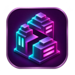
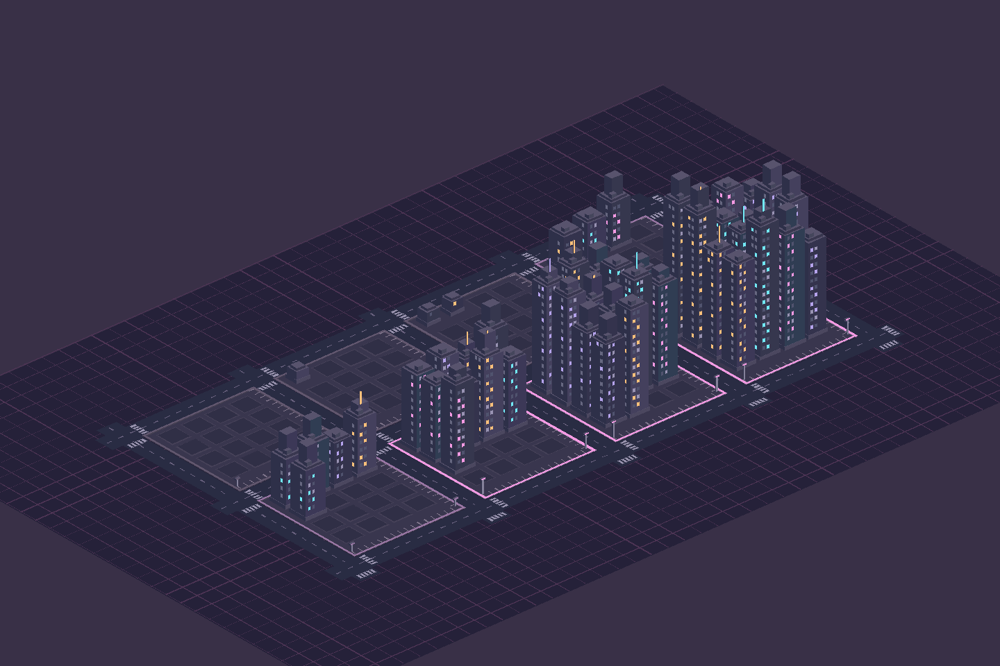

<div align="center">
  
  <h1>TheSitch</h1>
  <p><strong>Your work, a living city.</strong></p>
  <p>A desktop app that turns engineering contributions into a cyberpunk city.</p>
  <p>macOS · Windows · Linux · Electron · React · TypeScript · SQLite</p>
</div>

---

**TheSitch** brings pull requests, merge requests, commits, deliveries, and token usage together in an interactive dashboard. Each repository becomes a district that grows as your contributions accumulate. It helps you explore your work history with evidence and context.

**Volume does not equal quality or impact.** The indicators describe the records available. Weekends, holidays, and days off without contributions do not count against performance.

## Contents

- [Features](#features)
- [Integrations](#integrations)
- [Getting started](#getting-started)
- [Configuration](#configuration)
- [Reading the city](#reading-the-city)
- [Imports and history](#imports-and-history)
- [Privacy and data](#privacy-and-data)
- [Development](#development)
- [Limitations](#limitations)
- [Contributing](#contributing)
- [License](#license)

## Features

- **Interactive city:** repository districts, gradual growth, time-based lighting, and animated vehicles and pedestrians.
- **Period metrics:** track deliveries, PRs, commits, and tokens over the last 30 days or a custom range.
- **Mayor Meter:** five delivery pace levels, with a configurable calendar and comparison against your history.
- **City Signal:** a mayor's assessment with a local summary and optional AI analysis through Codex CLI.
- **Mayor Ranking:** rank, average, and comparison with active authors in accessible GitHub repositories.
- **Transparent imports:** synchronization every 10 minutes by default, incremental saves, resumption, and a detailed import history.
- **AI tokens:** local Codex and Claude Code session usage, including subagents, attributed to repositories.
- **Portable configuration:** configurable sources, calendar, and paths, with preference import and export.
- **Demo mode:** explore synthetic data without connecting accounts.

<details>
<summary>Preview the city</summary>



A rendering using synthetic data to show different stages of development. This is not a screenshot of the full interface.

</details>

## Integrations

| Source | Data collected | Authentication |
| --- | --- | --- |
| GitHub | Your PRs, reviews, commits, and production confirmation when available | GitHub CLI (`gh`) |
| GitLab.com / private GitLab | Your MRs and commits, with commit-to-MR association | GitLab CLI (`glab`) |
| Bitbucket Cloud | Your PRs and commits, with commit-to-PR association | Atlassian email and API token in a local file |
| Azure DevOps | Work items assigned to the connected account | Azure CLI (`az`) and the `azure-devops` extension |
| Codex | Token usage from local sessions | Local files |
| Claude Code | Token usage from local sessions | Local files |

Sources can be used together. GitLab and Bitbucket support explicitly selected team or personal projects. **The GitHub integration still requires configured organizations.** The ranking compares GitHub authors only.

## Getting started

### Requirements

- macOS, Windows, or Linux. Native Windows and Linux builds have not yet been validated.
- **Node.js 24 or later** and **pnpm 11.18.0** to run or build from source.
- Authenticated CLI tools and accounts only for the integrations you enable.

### Run from source

After obtaining the code, open a terminal in the project directory:

```sh
npm install --global pnpm@11.18.0
pnpm install --frozen-lockfile
pnpm dev
```

To run a production build:

```sh
pnpm build
pnpm start
```

### Package the app

Run packaging commands on the target operating system:

```sh
pnpm package
```

The default targets are DMG and ZIP on macOS, NSIS installer and ZIP on Windows, and AppImage and tar.gz on Linux. Output is written to `release/`. Use `pnpm package:dir` for an unpacked app or `pnpm package:zip` for a ZIP archive on the current platform.

Local macOS packages use ad hoc signing and are not notarized. Native Windows and Linux packaging and runtime behavior are pending validation.

### First use

1. Open **Explore demo** to try the interface without connecting services.
2. In **Settings**, set your name, city name, and desired sources.
3. Authenticate integrations and select the organizations or repositories to track.
4. Save and start synchronization. Historical collection begins on **January 1, 2026**.
5. Open **Imports** to see what has been saved and what is still pending.

On macOS and Windows, closing the window keeps the app running when a tray icon is available. On Linux, closing the window quits the app. Quit the app completely before replacing it with a new version; on macOS, use **⌘Q**.

Launch at login is supported for packaged macOS and Windows apps. On Linux, configure startup through your desktop environment; the in-app preference does not register an autostart entry.

## Configuration

Preferences are available in the interface. [`thesitch.config.example.json`](thesitch.config.example.json) provides a generic starting configuration; older configurations receive defaults for newer sources.

### GitHub

Authenticate the CLI:

```sh
gh auth login
```

Enter your login and organizations in settings. The app can discover organizations accessible to the authenticated account. For another GitHub host, configure the host and authenticate `gh` against it.

### GitLab

Install the [GitLab CLI](https://docs.gitlab.com/cli/) and authenticate:

```sh
glab auth login --hostname gitlab.com
```

Replace the host for a private instance. Under **Sources and tools → Connect GitLab**, provide:

- Host, authenticated username, and the path to `glab` if needed.
- One project per line: `group/subgroup/project` or `user/project`.
- Email addresses used to author your commits, including `noreply` addresses when applicable.

The app also uses email addresses returned by the account API. See the [official authentication options](https://docs.gitlab.com/cli/authentication/).

### Bitbucket Cloud

No CLI is required. Create an **Atlassian API token** with the `read:user:bitbucket`, `read:repository:bitbucket`, and `read:pullrequest:bitbucket` read scopes, following the [authentication documentation](https://developer.atlassian.com/cloud/bitbucket/rest/intro/).

Save only the token in a private file outside the project. On macOS and Linux, restrict file permissions:

```sh
chmod 600 ~/.config/thesitch/bitbucket-token
```

On Windows, open the file's **Properties → Security → Advanced**, disable inherited permissions, and allow read access only to your account, SYSTEM, and Administrators. The app checks these ACLs through PowerShell before reading the token. Under **Connect Bitbucket Cloud**, enter your Atlassian email, account UUID or `account_id`, the absolute file path, and one `workspace/repository` per line. Find the account identifier in Bitbucket settings or through the authenticated `/2.0/user` API.

The token contents are not stored in SQLite or exported settings. Do not paste the token into the path field or shared commands.

[Associating commits with PRs](https://developer.atlassian.com/cloud/bitbucket/rest/api-group-pullrequests/#api-repositories-workspace-repo-slug-commit-commit-pullrequests-get) requires **Pull Request Commit Links**, enabled through **Go to pull request** on a commit page. When links are unavailable or still being processed, the step remains pending to avoid double counting.

After saving, use **Check saved GitLab and Bitbucket** to verify authentication.

### Azure DevOps

Set up `az`, authenticate, and install the `azure-devops` extension. In the app, enable the source and enter the organization and projects. Collection uses the connected account to query its assigned work items.

On Windows, `.cmd` and `.bat` Azure CLI launchers are not supported; configure a native executable instead.

### Codex, Claude Code, and AI analysis

Default read paths:

| Tool | Path |
| --- | --- |
| Codex | `~/.codex/sessions`, including archived sessions |
| Claude Code | `~/.claude/projects` |

Use folder mapping to associate sessions with repositories. Ambiguous names across platforms can be resolved using the repository ID.

**AI analysis** is optional and uses an authenticated Codex CLI with a configurable model. When enabled, it sends selected metadata for analysis. Sending diffs is a separate option available only for GitHub. Token usage from TheSitch's own analyses is shown separately.

### Calendar

Configure the time zone, working days, vacation, days off, and additional holidays. Brazilian national holidays can be fetched automatically through BrasilAPI; optional public holidays are not automatically treated as days off.

No contributions on non-working days is neutral. Periods without enough coverage remain in calibration, and the current day is provisional.

## Reading the city

| Element | Meaning |
| --- | --- |
| District | A repository with identified contributions |
| Occupancy and height | Accumulated development based on PRs and independent commits, respecting groupings |
| Illuminated modules | Commits; the label retains the total even when the drawing reaches its visual limit |
| Energy | Token usage, broken down by tool and attribution |
| Mayor Meter | Delivery pace relative to history, not quality or business impact |
| City Signal | Evidence summary and mayor's assessment |

The date filter changes metrics and stories **without shrinking the accumulated district**. Replay lets you view an earlier point in time. Commits associated with PRs are recorded but do not create duplicate independent deliveries.

Vehicles and pedestrians are decorative. Lighting follows the current time in the configured time zone, regardless of the selected period.

### Controls

| Action | Control |
| --- | --- |
| Zoom in / out | Scroll or zoom buttons |
| Rotate | Right-click and drag horizontally |
| Pan | Left-click and drag the background |
| Find a repository | **Go to district** selector or district list |
| Reset camera | **Center** |

The city displays eight districts per page to limit graphics cost. Reduced motion can be enabled in preferences.

## Imports and history

Synchronization runs every **10 minutes by default**, with a configurable interval. Each source has its own history and checkpoint.

- Data is saved during collection, before the entire source finishes.
- Completed queries can be reused when resuming an interrupted attempt.
- The checkpoint advances only when the source completes its steps.
- Incremental updates overlap by 24 hours to recheck recent changes.
- Pausing or quitting preserves data already saved.
- The **Imports** screen shows periods, steps, saved records, errors, and pending work.

The GitHub ranking runs separately every two hours by default, with one- and three-hour options and manual refresh. It considers human authors with merged PRs in accessible repositories, not every employee in an organization.

Use a full recheck to review older data that may have changed outside the incremental window. A successful query does not guarantee recovery of deleted or inaccessible data.

## Privacy and data

TheSitch uses **local SQLite** with WAL. By default, data is stored in Electron's `userData` directory; on macOS this is usually:

```text
~/Library/Application Support/TheSitch/
├── thesitch.sqlite
└── operations.jsonl
```

- Credentials remain in authenticated CLI tools or the external Bitbucket token file.
- Local session reading stores usage counts and metadata without copying conversations into the database.
- Contribution metadata, such as PR titles and descriptions, is stored locally.
- When enabled, AI analysis may send selected metadata to the Codex service.
- The app does not post comments, create PRs, or modify work items in connected services.

Quit the app before manually backing up the database. `THESITCH_DATA_DIR` can specify a separate directory for testing.

Exported settings may contain names, organizations, and local paths; review them before sharing. When switching people on the same installation, use a different workspace identifier. Disabling a source hides its data without deleting it.

## Development

### Commands

| Command | Purpose |
| --- | --- |
| `pnpm dev` | Run with development reload |
| `pnpm check` | Check lint and formatting |
| `pnpm format` | Apply lint and formatting fixes |
| `pnpm typecheck` | Check TypeScript types |
| `pnpm test` | Run automated tests |
| `pnpm test:worker` | Test the worker, IPC, and SQLite in the Electron runtime |
| `pnpm test:e2e` | Run Playwright UI tests |
| `pnpm build` | Create a production build |
| `pnpm package:dir` | Create an unpacked app for the current platform |
| `pnpm package:zip` | Create a ZIP for the current platform |
| `pnpm package` | Create the default packages for the current platform |

Window tests require a compatible graphical session. Connector tests use mocked responses; also validate with a test account before claiming compatibility with a specific instance.

### Structure

```text
src/
├── main/           # Electron process, IPC, and service coordination
├── backend/        # SQLite, metrics, history, and ranking
├── integrations/   # Connectors, CLIs, and local session reading
├── renderer/       # React UI and city rendering
└── shared/         # Shared types, validation, calendar, and rules
tests/              # Domain, integration, and UI tests
scripts/            # Checks and build utilities
build/              # Icons and packaging assets
```

The domain has workspaces and members to separate identities. **Multiplayer is not implemented:** there is no server, invitation system, or synchronization between computers.

## Limitations

- Native Windows and Linux builds and runtime behavior are pending validation. Intel Mac distribution has not been validated.
- Windows Azure CLI `.cmd` and `.bat` launchers are unsupported; configure a native executable.
- Bitbucket Data Center is not supported.
- GitLab/Bitbucket reviews, deployments, and diff statistics are not collected. Ranking is GitHub-only.
- GitLab attributes commits using configured or account-returned email addresses. Bitbucket uses the author's account link and does not infer identity from a name.
- Bitbucket commit collection may traverse the inventory to apply the date range locally, so incremental collection may cost more than other sources.
- GitLab/Bitbucket collection has a defensive limit of 100 pages. Reaching it leaves the step pending instead of claiming complete coverage.
- Indexes, permissions, API pagination, and deleted records limit coverage. Old commits published late may require a recheck.
- Local Codex and Claude Code formats may change. Only files available on the computer can be recovered.
- There is no integration with revenue, incidents, or product analytics; business impact is not inferred from PR, commit, or token volume.

## Contributing

Contributions are welcome. Before proposing a change:

1. Describe the problem and expected behavior; for bugs, include reproduction steps and relevant versions.
2. Keep the change focused and add tests for behavior changes.
3. Run `pnpm check`, `pnpm typecheck`, and `pnpm test`.
4. For Electron process or persistence changes, also run `pnpm test:worker`.
5. Explain how you validated the change and report known limitations.

Do not include tokens, personal databases, conversations, or private repository information in examples, issues, or pull requests.

## License

This repository does not yet have a `LICENSE` file. A license must be chosen before distribution as an open-source project.
